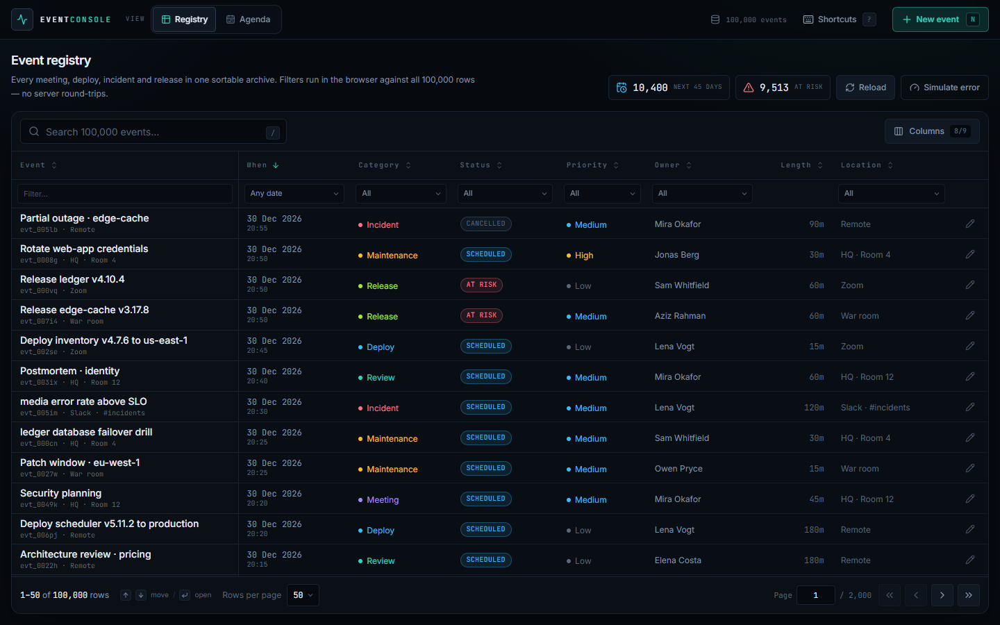
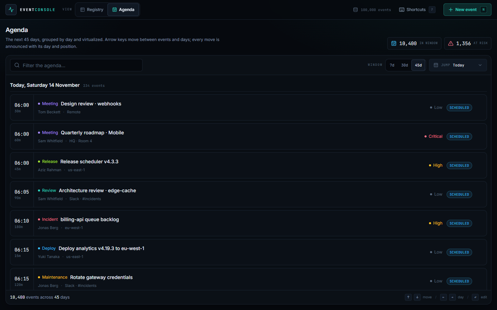
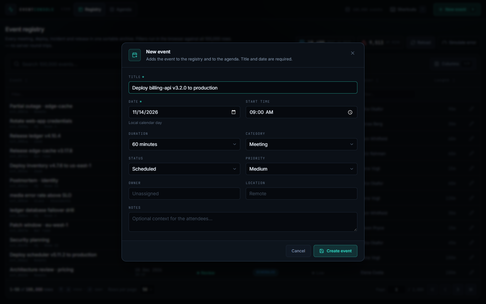

# Event Console

Three reusable React components — a **DataGrid**, a **Timeline**, and an
**EventForm** — driven by a small ops-console demo with **100,000 events**.

The demo is deliberately boring infrastructure: one shared event store, two
views over it, and a modal editor. The interesting part is what happens when the
data set is large enough that a naive table stops being usable.

**Live demo:** [event-console-ruddy.vercel.app](https://event-console-ruddy.vercel.app) · [Grid](https://event-console-ruddy.vercel.app/grid) · [Timeline](https://event-console-ruddy.vercel.app/timeline)

```bash
npm install
npm run dev        # http://localhost:5173
```

- `/grid` — 100,000-row registry with client-side filtering, sorting, pagination
  (including a typed page jump)
- `/timeline` — 10,400 events in the default 45-day window, grouped by day
  with a sticky current-day header and a calendar jump-to-date control
- “New event” writes to both views through the same Zustand store

## Screenshots



*The 100,000-row registry: full-set counts, per-column filters, and a page of 50 virtualized rows that open on click or Enter.*



*The agenda: 10,400 events over 45 days, grouped into virtualized day sections.*



*The editor: controlled fields, an in-app calendar and a 24-hour time picker, a live end-time preview, and required-field validation.*

## Stack

React 19 · TypeScript (strict) · Vite · Tailwind CSS v4 · TanStack Table v8 ·
TanStack Virtual · Zustand · Radix Dialog/Dropdown Menu · React Hook Form ·
Zod · date-fns · Vitest + Testing Library.

## What is actually reusable

| Component | Responsibility |
| --- | --- |
| `src/components/DataGrid` | Generic table: configurable columns, resizing, visibility, per-column text, multi-select facet and date filters (with per-option counts), global search, sorting, pagination, virtualized rows, row activation with a roving tab stop, optional controlled row selection with a floating bulk-action slot, loading/empty/error states, row reveal, and a narrow layout that drops breakpoint-hidden columns and hands the row to its primary cell. |
| `src/components/Timeline` | Generic grouped timeline: variable-height day groups, virtualization, roving `tabindex`, arrow-key navigation, live announcements. |
| `src/features/events/components/EventForm` | Event-specific create/edit dialog: validation, focus management, dirty-state discard confirmation, delete confirmation, save error region. |

The demo owns the event-specific bits (`features/events/registry/columns.tsx`,
`features/events/agenda/agendaData.ts`, the view pages, and
`features/events/model/generate.ts`). The generic components only know about a
row shape, a column definition, and an item renderer.

See [`docs/architecture.md`](docs/architecture.md) for the dependency rules,
folder boundaries, and the reasoning behind the split,
[`docs/refactoring.md`](docs/refactoring.md) for the controller-hook refactor,
and [`docs/assignment-audit.md`](docs/assignment-audit.md) for the
requirement-by-requirement audit.

## Architecture

```
App (routes, lazy-loaded pages + form, toast, global shortcuts)
 ├── /grid     RegistryPage ── DataGrid ── useDataGridController
 │                                ├── buildRows(full data)  ← filter + sort
 │                                └── TanStack Table (current page only)
 └── /timeline AgendaPage   ── Timeline ── agendaData grouping/windowing
                                  ├── useTimelineFocus / useTimelineKeyboard
                                  └── TanStack Virtual
 shared Zustand store: 100k seeded events, create/update, load/error status
```

The stateful view logic lives in controller hooks (`useDataGridController`,
`useTimelineFocus`, `useTimelineKeyboard`, `useEventFormController`); the
components themselves are mostly composition and markup.

### The 100k-row problem

TanStack Table is excellent, but its row models are proportional to the data you
hand it. Passing 100k rows into `useReactTable` means every data mutation
rebuilds 100k `Row`/`Cell` objects and re-runs sorting. In this app that showed
up as a multi-second freeze after Save (and a large GC pause), because adding
one event changes the `data` array identity.

The grid therefore owns the full-set pipeline:

1. `buildRows()` filters the plain `EventRecord[]` and sorts it with
   **precomputed sort keys** — one key per row, not one accessor call per
   comparison.
2. Only the current page (25/50/100/250 rows) is passed to `useReactTable`,
   with `manualPagination`, `manualSorting`, and `manualFiltering`.
3. TanStack Virtual renders only the visible rows of that page.

The table's row model is now page-sized. Adding an event costs one linear
filter pass plus one 100k sort (~100 ms of comparator work), not 100k row
allocations. The same change also fixed the freeze that was swallowing the
“return focus to opener” callback after Save.

**Sorting detail:** TanStack's default `alphanumeric` sorter runs a natural-sort
regex over both values for every comparison. Over 100k rows that is ~1.5M
regex passes. The demo columns use simple `text` comparisons, numeric rank keys,
or an ISO timestamp key, so the same sort is a plain comparison. Formatting
(dates, status badges) only happens for rendered cells.

### Data and state

- `src/features/events/model/generate.ts` creates a deterministic 100k data set
  with a seeded `mulberry32` PRNG. Dates are relative to the current day, so the
  demo stays “live” whenever it is run.
- Every record has a precomputed lowercase `search` string so global search is
  one `includes` call per row.
- `src/features/events/store/events.ts` is the single source of truth. Creating
  an event prepends it to the same array the timeline reads, which is why the two
  views cannot drift.
- Loads include a small artificial latency (and a “Simulate error” action) so
  the loading/error/retry states are demonstrable.
- Column filters are **multi-select facets**. A column holds several values at
  once, meaning "either": `?category=meeting&category=deploy` is one filter, not
  two. The menu is a checkbox list that stays open while you pick, each option
  shows how many events it would leave with the other filters applied, and every
  chosen value gets its own chip — so dropping one choice keeps the rest, and the
  last removal clears the filter instead of leaving an empty one behind. The menu
  is keyboard-operable (Enter opens with the first option focused, Space toggles,
  Escape returns focus to the trigger) and deliberately non-modal, so the result
  count keeps announcing as values are chosen. `Clear` stays pinned to the foot
  of the menu, where a long facet cannot scroll it away.
- Both views are **shareable**. The registry round-trips search, column filters,
  sort, page and page size
  (`/grid?q=deploy&category=meeting&category=deploy&sort=title:asc&page=2&size=25`); the agenda
  round-trips the same search plus its window, at-risk filter and focused day
  (`/timeline?q=billing&window=30&at=risk&day=2026-11-18`). The default view
  stays out of the URL, and a hand-edited link is validated before it reaches
  the view — unknown columns, values, windows and impossible days are dropped
  instead of trusted. External URL changes (nav click, Back) re-seed the view;
  the page's own writes use `replace` so filtering never floods history.
- Search is the one filter both lenses understand, so switching Registry ↔
  Agenda keeps `q` instead of silently dropping what was typed. The **Next 45
  days** metric deliberately opens a clean agenda, because its count is
  unfiltered.
- The header metrics are live: **At risk** toggles the registry's status quick
  filter and narrows the agenda to at-risk events, while **45 days** opens
  the agenda window it counts. The number, the pressed card, the chip and the
  filter row therefore always agree: the card reads pressed only while the
  status filter is exactly that one value, so it never claims a count the grid
  is not showing.

### One data set, two views

The header switcher is deliberately a single sliding lens rather than two
independent page links: **Registry** and **Agenda** are lenses on the same event
store, not separate destinations. A shared surface makes that relationship
visible, gives the active mode one consistent treatment, and keeps both targets
reachable at 320 px without a navigation drawer. The labels match the page
headings (“Event registry” / “Agenda”), so the control names the user's mental
model instead of the widget behind it; the icons carry the representation.

The track is a recessed capsule and the active lens is a lit accent surface — a
vertical accent gradient, a one-pixel accent edge, a faint accent glow that the
track clips so it cannot bloom over its hairline, semibold label, accent icon —
so the current mode is a colour you can find without reading. The previous treatment (a raised chip with a ring and a drop shadow)
put a box inside a box, and on a dark surface the 6% step between `raised` and
`canvas` was not a selection cue at all: the only real signal was the icon's
colour. A lit capsule says it outright, and the agenda's 7/30/45-day window
wears the same one.

The surface slides between the two cells in 300 ms (disabled under
`prefers-reduced-motion`) and presses in slightly on tap. The focus ring is
drawn inside the track so it is never clipped, and it turns from accent to ink
on the selected segment, whose own edge is already accent. Each segment also
shows the key that reaches it (`G` / `T`) above `xl`, so the control teaches the
shortcut instead of leaving it to the tooltip.

From `xl` up the switcher takes the middle of the bar — brand, lens, actions —
rather than sitting in the gap after the wordmark with 500 px of empty header
to its right; below that it stays in the brand cluster, where the bar is too
narrow to give away the centre. It is 42 px tall when centred (a 32 px segment
in a 4 px padded track) and 38 px on a phone, where it sits level with the 36 px
buttons beside it. The dataset count appears at `lg`, not `md`: between 768 and
1023 it had to share a 736 px bar with the wordmark, the switch, Shortcuts and
New event, and wrapped both itself and the button onto two lines.

Both pages also share one shell: a page header with two metric cards and the
page actions, then a single panel with a toolbar, a scrolling body and a status
footer. The agenda's search, window and jump controls sit in its panel toolbar,
the same slot the grid uses for search and the column menu. `Button`,
`SearchField`, `Stat` and the classes in `components/ui/surfaces.ts` keep the
control heights, radii and states identical across both views.

On a phone the header drops its wordmark and the Shortcuts button, and the
page's own maintenance actions collapse to icons, so the switcher, the counts
and the panel — the actual work — keep the screen.
Page descriptions are one short line, because a paragraph that wraps to four
lines pushes the work below the fold. The panel toolbars tighten the same way:
search takes a full row of its own, with the `/` hint hidden (no keyboard to
press it); **Filters**, **Export** and **Sort** keep their words, because a
phone has no hover tooltips and four bare icons asked the reader to guess;
**Density** is a desktop preference and leaves below `sm`, and **Columns** leaves
below `md`, where the table no longer renders the columns that menu toggles.
Reload and the overflow menu wrap as one right-aligned pair instead of
stranding the “…” on its own line; the agenda keeps its previous/next day
buttons — full-size 40 px targets — and drops the date picker's “Jump” label.
An applied filter is a dot on the Filters button rather than a number, because a
badge pushed the row onto a second line at 320 px. The chip strip drops its
“Filters” prefix at that width so the first chip and “Clear all” stay on one
line. The footer collapses to one 53 px row: `1–50 of 100,000`, a tappable page
field, and previous/next. First/last and rows-per-page are hidden there — a
thumb cannot usefully hit four chevrons, and the page field already jumps in one
tap.

A phone header reads title, then its two icon actions at the right edge, then
the metric cards as an even two-up row filling the panel width; from `sm` up it
is the single row of title, cards and actions. Cards are `shrink-0`, so nothing
is clipped to its label — the window metric says “45 days” instead of “Next 45
days” to buy that room, with the calendar icon and card title carrying “next”.

Below `md` the grid stops pretending it has room for a desktop header. The
filter row — one control per column, a few dozen pixels high — is replaced by a
**Filters** button that opens a sheet listing every filterable column,
including the ones the table itself hides on a narrow screen. It reuses the
exact same controls as the desktop row, so the two surfaces cannot drift apart;
the trigger carries the number of applied filters and the sheet pins **Clear
all** and **Done** to its foot.

The row changes shape at the same breakpoint. A phone cannot show eight columns,
and scrolling right to reach Status carried the event title off screen — every
row read “… 2026 SCHEDULED Low” with no way to tell which event it was. So
`When`, `Status`, `Priority` and `Notes` leave the rendered table, and the
primary cell becomes a two-line card: title and status badge on the first line,
`day · time · category · priority · location` on the second. Only the checkbox
gutter, that cell and the row's pencil are left, so the table fits a 360 px
viewport exactly — no horizontal scroll at all. The hidden columns stay in the
grid's state, so a filter, a sort or a shared link that names them still works,
still shows a chip, and still sorts; only the markup gets narrower. The
narrow/wide decision is published once through `GridLayoutContext`, so fifty
rows do not mean fifty `matchMedia` listeners and the same fact is never in the
DOM twice. The narrow row is two lines by construction, so it forces a 52 px
height: density remains a wide-screen preference.

When the table is wider than its viewport, the grid fades the right edge
instead of cutting it off, so horizontal overflow reads as something you can
swipe. That is the `md`-and-up case, where the full column set returns. The
empty state offers its own way out — the query variants clear the search or
  the filters, and an empty data set reloads the dataset in place instead of
  explaining which header button to press.
  The first column is pinned at every width, and in the registry that is
  the 32 px selection gutter: the checkboxes never scroll away from the row they
belong to, and on a phone that is all the horizontal space pinning costs. The
left edge needs no fade because nothing ever hides under it.

Load failures look the same in both lenses: `components/ui/ErrorState.tsx` owns
the panel, the registry titles it “Could not load rows”, the agenda “Could not
load events”, and both offer the same **Retry**. A failed load never leaves a
stale timeline or an empty table behind. While the error is up the grid also
drops its pagination footer and its result-count status, because paging a data
set that failed to load is not an action worth offering.

Filtered results stay explainable: the grid footer reads “filtered from
100,000” whenever search or column filters narrow the set, and the agenda keeps
its own total in the same footer slot. **Export** writes that same set, not the
whole data store — the control says “filtered rows”, so a narrowed view now
produces a narrowed CSV — and confirms it in the toast (“Exported 3,797 events
to events.csv.”). Exporting 100,000 rows while the footer said 3,797 was a
silent contradiction the download could not explain.

Press `?` anywhere outside a field or overlay — or use the **Shortcuts** button
in the header — to open the keyboard cheatsheet. It groups shortcuts by where
they apply, so the ones you would otherwise discover by accident are documented
in the product rather than only in this README.

### Timeline

`features/events/agenda/agendaData.ts` windows the store by calendar day, groups
by day, and flattens groups + items into one virtualized list. The timeline
component is generic over the item type and gets a `renderItem` callback.

Navigation is a roving `tabindex`:

- **Up / Down** — previous/next event
- **Left / Right** — first event of the previous/next day
- **Home / End** — first/last event in the window
- **Enter / Space** — edit the focused event
- Tab moves into the timeline once; subsequent arrows keep the active item in
  the tab order.

Every focus move updates a polite live region with the day and position:
`Today, Friday 13 November: Deploy edge-cache, 3 of 52`.

Day headings lead with `Today` or `Tomorrow` before the date, so a jump, a
window change or a fresh search landing mid-list still tells you where you are.
Changing the window or the query resets the list to the top; adding an event to
a day you are already reading does not. Once you have jumped to another day the
toolbar offers a one-click **Today** action to come back.

The jump calendar marks today separately from the selected day, dims and
disables days outside the current window, dims its month arrows at the edges of
that window, and shows a **Today** action only when today is not already
selected.

### Form

`EventForm` is a Radix Dialog controlled by the app. React Hook Form handles
field state; Zod validates the schema (title required, date required and a real
calendar date, time `HH:mm`, duration bounds).

- Nothing is validated until **Create event** / **Save changes** is pressed;
  from then on the fields re-validate as they are edited. Blur validation cannot
  tell “I finished with this field” from “focus moved because I clicked the X”,
  and with the title auto-focused the second reading made the close button look
  like it was demanding a title.
- Submit runs validation, focuses the **first invalid field**, and keeps the
  dialog open.
- Closing a dirty form opens a second confirmation step (“Keep editing” /
  “Discard changes”); “Keep editing” returns focus to the form. Leaving is not
  submitting: the close path clears validation first, because blurring the
  auto-focused title is what clicking the X does, and the prompt has no business
  arguing about a field the user is abandoning.
- The opener element is captured before the dialog opens and focused again on
  close, including after a successful save.
- Save errors render in a `role="alert"` region; the dialog and the entered
  values stay put so the user can retry.
- Editing offers **Delete**, which asks first (“Keep event” gets focus).
  Confirming closes the dialog and shows a toast with **Undo**; undo puts the
  event back at the index it was removed from.
- The toast is dismissible. Only its sentence is the live region: the Undo and
  Dismiss buttons sit beside it, because an interactive control inside
  `role="status"` is read out as part of the announcement and is awkward to
  reach while it plays. Dismissing also drops the undo it carried, so no later
  click can act on something the user can no longer see.

## Measured performance

Local production preview (`npm run build && npm run preview`) in Chrome. Times
include React rendering and, where relevant, the intentional mock latency. They
will vary by machine; the shape is what matters.

| Scenario | Result |
| --- | --- |
| First `/grid` paint → 100k rows, first page rendered | **~0.9 s** (includes 120 ms simulated fetch) |
| Global search `deploy` over 100k rows → 17,724 matches | **~255 ms** |
| Status filter `At risk` → 9,513 matches | **~197 ms** |
| Date filter `2026-10-30` → 234 matches | **~115 ms** |
| Sort by Event title over 100k rows | **~439 ms** |
| Save → dialog closed, toast shown, new row revealed | **~0.9 s** (includes 380 ms mock save) |
| Grid table row model | **50 rows**, regardless of data size |

The first load is the one place where the whole data set is unavoidable: it is
generated, filtered/sorted once, and rendered with a skeleton. After that,
mutations only pay for the sort/filter pass.

## Accessibility notes

- **Grid semantics:** a real `<table>` with a caption, `aria-sort` on sortable
  headers, labelled filter controls, and `aria-rowcount` / `aria-rowindex` that
  account for the header rows. Virtualized rows keep their real row number, so
  “row 10,352” is still announced as row 10,352.
- **The header is one tab stop.** Sort buttons are individually focusable, which
  put eight of them between the select-all checkbox and the first row. The
  header now uses a roving tabindex: exactly one sort button is a stop, parked on
  the column currently sorting (or the first one), and ←/→ move between the rest
  without adding stops. A **Skip to content** link is the first thing Tab
  reaches, so the header's nav and actions can be stepped over entirely; it
  targets `<main>`, which takes focus without a visible outline of its own.
- **Live counts:** the result count (“100,001 rows match. Showing 10,301 to
  10,350.”) is a polite status region.
- **Rows are the control:** every row opens the editor — click it, or focus it
  and press Enter/Space. The page of rows shares one tab stop, moved with ↑/↓,
  Home and End, so a 50-row page does not add 50 tab stops. The pencil at the
  end of each row is the visible cue for that action and stays out of the tab
  order, and the footer spells the model out (`↑ ↓ move / ↵ open`).
- **Timeline:** roving tabindex, `aria-label` per item with the event title and
  “Event n of m”, day headings, and the live announcement described above. The
  keyboard help text is wired up with `aria-describedby`.
- **Forms:** every field has a visible label; errors set `aria-invalid` and are
  referenced with `aria-describedby`; submit focuses the first invalid field.
  Radix Dialog provides the focus trap, Escape handling, and focus restoration.
  The four choice fields (duration, category, status, priority) use the same
  in-app menu as the grid's select filters — a `SelectMenu` trigger named by the
  field label, so `getByLabelText` and screen readers see one control either way
  — instead of handing the keyboard to the operating-system `<select>` popup.
- **Reduced motion:** the global stylesheet collapses animations/transitions
  under `prefers-reduced-motion: reduce`.
- **Keyboard shortcuts:** `/` focuses grid search, `f` focuses the first column
  filter, `x` ticks or unticks the focused row, `Escape` clears an active search,
  `n` opens the new-event dialog, `?` opens the shortcut cheatsheet, `g` and `t`
  switch between the Registry and Agenda views, and all dialogs close with
  Escape. Shortcuts are ignored while
  typing in a field or when a dialog or menu owns the keyboard.
- **One Escape contract for search:** `SearchField` owns it, so both search
  boxes behave the same — Escape clears what is typed and keeps the caret in the
  field, and a second Escape (or the first, when the field is already empty)
  leaves it. Clearing never depends on finding the X.
- **Search vs filters:** global search and column filters are independent. The
  search input stays urgent while the applied query waits for a 200 ms pause in
  typing, and clearing it is immediate. Active column filters appear as
  removable chips — including filters whose column is hidden — grouped in one
  strip under the toolbar; a quiet **Clear all** sits at the far end of that
  strip, so clearing filters never competes with the search field and never
  throws away the query.
- **Sorting:** the registry opens on **nearest to today** — today first, then
  forward, with history behind it — rather than newest-first, because “newest”
  on a 45-day future window opens 44 pages away from what is happening now.
  That order belongs to a hidden, sort-only column, so the toolbar **Sort** menu
  names it in words (Nearest to today, Newest, Oldest, Title A–Z, Priority) and
  is the only way back to the default once a header arrow has been clicked. The
  menu and the header arrows write to the same `SortingState`, and only a
  non-default order reaches the URL.
- **Column filter row:** filters stay quiet until they are doing something. An
  applied control takes the accent border and a tinted fill, text and date
  filters grow a one-click clear button, and the column header marks a filtered
  column with an accent dot. Select filters open an in-app menu — the native
  `<select>` popup is drawn by the operating system and breaks the console
  palette — with the current option checked and an **All** item to reset. The
  When filter opens the shared calendar instead of the browser's date input,
  spells the applied day out in the trigger and in its chip, and offers Today as
  a shortcut. Scanning the row is therefore enough to see which columns are
  narrowing the view, while the chip strip remains the universal removal
  surface.
- **Column visibility:** the Columns menu marks each visible column with a
  check, stays open so several columns can be toggled in a row, and “Show all
  columns” reveals every hideable column instead of resetting to the initial
  set. It is hidden below `md`, where the narrow row replaces those columns with
  the primary cell, so it never offers a toggle that cannot change the screen.
- **Row selection and bulk delete:** ticking a row (or the header, which selects
  the page and shows a mixed state for a partial selection) floats a compact
  action bar above the footer instead of adding a strip that shifts the table.
  The row itself is the keyboard surface, so `x` toggles the row you are on: fill
  a selection with `↓` and `x` instead of tabbing into and out of every checkbox.
  After a delete, focus returns to the row the user was on, because the bar's
  Delete button unmounts with the selection and Radix then had nowhere to send
  it — which dropped keyboard users on `<body>` and cost them their place.
  The bar names the count, clears the selection, and opens a confirmation that
  previews the first few selected events — the check that matters when the
  selection has survived a page or filter change. Deleting goes through the same
  toast + Undo path as the single-event delete, and clearing the selection
  actually unchecks the boxes because the page owns the ids. The checkbox column
  is sized like the utility it is, not like a data column.
- **Select all matching.** The header checkbox can only reach the page, which is
  the wrong unit on a 2,000-page result set. Once a full page is ticked, the bar
  offers **Select all 9,513 matching**: the grid publishes the rows the current
  search and filters left (`filteredRowsRef`), and the page takes their ids — no
  second filter pass over 100k rows. The offer only appears once the page is
  fully selected, so it never competes with ticking a single row, and it
  disappears when everything matching is already selected. The confirmation
  spells out the split (“50 on this page, 9,463 elsewhere”) before the count it
  is about to delete, and the bar writes counts with separators (`9,513`, not
  `9513`) so a five-digit number stays readable. Its visible copy says “selected”
  at every width; only the “outside this view” clause is dropped on a phone,
  where the dialog carries the same warning.
- **A selection that tells the truth.** The selection is kept when the search or
  filters change, because narrowing the list to check one row should not throw
  away the twenty already ticked. But an action must not then imply it only
  touches what is on screen, so the grid walks the filtered rows (only while
  something is selected) and reports how many of them are still in view. The bar
  reads **12 selected · 3 outside this view**, its live region says the same in
  words, and the confirmation adds “3 of them are outside the current search and
  filters” before the count it is about to delete.
- **Row density and columns stick.** Both are personal taste rather than
  shareable view state, so they live in `localStorage` (versioned keys,
  validated on read, best-effort on write) while search, filters, sort and page
  stay in the URL. Choosing Compact and hiding Notes used to last until the next
  reload; now it lasts until you change your mind. A corrupt or stale value falls
  back to the default instead of handing the virtualizer an unknown row height.
- **Row density:** one named **Density** menu replaces the old “Comp / Comf /
  Spac” buttons. It spells out Compact, Comfortable and Spacious, previews each
  with a row-count icon and its pixel height, and checks the active choice; the
  trigger names the current value for assistive tech (`Row density:
  Comfortable`). It is hidden below `sm`, where the row is a fixed two-line card
  and density would change nothing visible.
- **One menu language:** every menu in the panel — select filters, the form's
  four choice fields, rows per page, column visibility — is an in-app Radix menu
  on the raised surface with a check on the current choice. No control hands the
  keyboard to an operating-system popup.

## Tests and quality checks

```bash
npm test          # 172 tests, 30 files
npm run build     # tsc -b (strict) + vite build
npm run lint      # oxlint
```

Coverage includes dataset determinism, search-text construction, store
create/update, grid sorting / filtering / pagination (including typed page jumps
and clamping) / focus-row reveal / filter-row clearing / the select and
date-filter menus / seeded and controlled filter state / controlled selection
and bulk delete (dialog preview, shared toast undo) / the select-all-matching
prompt and its formatted counts / the narrow primary cell and the roving header
tab stop, registry and agenda URL
view round-tripping and validation (including the nearest-to-today default and
its sort menu), the phone filter sheet and the media-query hook, the
quick-filter metrics, timeline grouping /
windowing / keyboard navigation / announcements, the shortcut cheatsheet, form
validation, draft mapping plus the discard flow (and closing without a
validation argument), the debounced-search hook, the
visual-viewport hook, the date-filter calendar, the registry view, the registry
header stats, scroll-edge detection, the shared search field's Escape contract,
the in-app select menu, the agenda's load-failure panel, and the event columns.

## Trade-offs and limitations

- **Client-side only.** The task asked for browser-side filtering/sorting, so
  the browser pays for the full data set. Above ~100k rows, or with server
  search, the same component API should be fed pages from the server instead.
- **Generic filter subset.** The grid understands `equalsString`,
  `includesString`, `equals`, `weakEquals`, and custom filter functions that use
  `row.original` / `row.getValue`. It does not implement every TanStack filter
  function. Custom sort functions receive a lightweight row shim; using
  `meta.sortValue` is the fast path and is what the demo uses.
- **Global search searches all columns**, not only visible ones. That is a
  deliberate simplification; scoping it to visible columns would be a small
  follow-up.
- **Columns resize** from the header handle; a column's default width comes from
  its `meta.width`. Reordering is not implemented.
- **Date filtering is exact-day**, not a range.
- **No persistence.** Refresh regenerates the deterministic data set and drops
  created/edited events. That keeps the demo self-contained.
- **Mock latency is intentional.** Save takes 380 ms and load 120 ms so pending
  and error states are visible; they are not measurements of real I/O.
- The timeline defaults to 45 days. Events outside the current 7- or 30-day
  scope are reachable by widening to 45 days; events outside 45 days remain in
  the store but are not shown by the current scopes.

## Project layout

```
src/
  app/                       composition root
    App.tsx                  routes, lazy form, global shortcuts
    components/              AppHeader, AppToast, RouteFallback, ShortcutsDialog
    hooks/useEventEditor.ts  editor state, submit, delete/undo, focus return, highlight
  features/events/
    model/                   types, seeded generator, search text, tests
    store/                   Zustand events store, useEventFeed, tests
    components/              EventLabels, EventForm (controller/fields/footer/schema/values)
    registry/                RegistryPage, header/stats, columns, primary cell, bulk bar/dialog, URL view
    agenda/                  AgendaPage, header, toolbar/footer, card, empty/skeleton, data
  components/
    DataGrid/                composition, hooks/, table/header/body, toolbar, selection slot, layout context, model/
    Timeline/                composition, hooks/, rows, model
    ui/                      PageHeader, EmptyState, ErrorState, SelectMenu, Kbd, Button, Checkbox, SearchField, Stat, surfaces
  shared/
    hooks/                   useGlobalKeydown, useTransientValue, usePersistentState
    lib/                     dates, formatting, cn, keyboard guards
    test/                    jsdom setup
```

Inside `features/events`, the model and store are the domain layer; registry
and agenda are views over that one event set. `DataGrid`, `Timeline`, and
`PageHeader` are generic and do not import event types.

## Scripts

| Command | Description |
| --- | --- |
| `npm run dev` | Vite dev server |
| `npm run build` | Type-check and build to `dist/` |
| `npm run preview` | Serve the production build |
| `npm test` | Run the Vitest suite once |
| `npm run test:watch` | Watch mode |
| `npm run lint` | oxlint |

---

Built as a technical task. The UI is a dark ops console; the data is entirely
mock. The commit history separates the scaffold, the dataset/store, and the
three components + demo so the evolution is reviewable.
