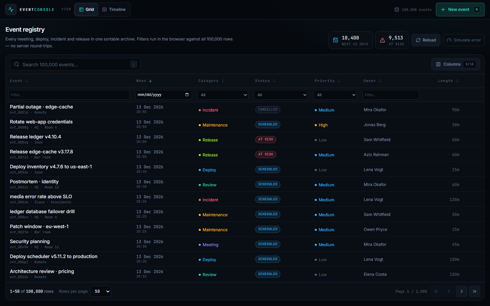
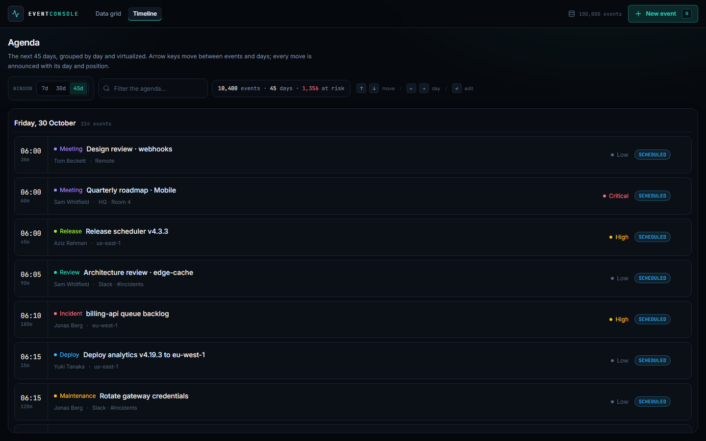
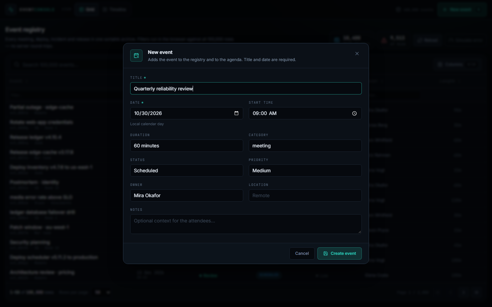

# Event Console

Three reusable React components — a **DataGrid**, a **Timeline**, and an
**EventForm** — driven by a small ops-console demo with **100,000 events**.

The demo is deliberately boring infrastructure: one shared event store, two
views over it, and a modal editor. The interesting part is what happens when the
data set is large enough that a naive table stops being usable.

**Live demo:** [event-console-ruddy.vercel.app](https://event-console-ruddy.vercel.app) · [Grid](https://event-console-ruddy.vercel.app/grid) · [Timeline](https://event-console-ruddy.vercel.app/timeline)

```bash
npm install
npm run dev        # http://localhost:5173
```

- `/grid` — 100,000-row registry with client-side filtering, sorting, pagination
  (including a typed page jump)
- `/timeline` — 10,400 events in the default 45-day window, grouped by day
- “New event” writes to both views through the same Zustand store

## Screenshots



*The 100,000-row registry: full-set counts, per-column filters, and a page of 50 virtualized rows.*



*The agenda: 10,400 events over 45 days, grouped into virtualized day sections.*



*The editor: controlled fields, a native date picker, and required-field validation.*

## Stack

React 19 · TypeScript (strict) · Vite · Tailwind CSS v4 · TanStack Table v8 ·
TanStack Virtual · Zustand · Radix Dialog/Dropdown Menu · React Hook Form ·
Zod · date-fns · Vitest + Testing Library.

## What is actually reusable

| Component | Responsibility |
| --- | --- |
| `src/components/DataGrid` | Generic table: configurable columns, visibility, per-column text/select/date filters, global search, sorting, pagination, virtualized rows, loading/empty/error states, row reveal. |
| `src/components/Timeline` | Generic grouped timeline: variable-height day groups, virtualization, roving `tabindex`, arrow-key navigation, live announcements. |
| `src/features/events/components/EventForm` | Event-specific create/edit dialog: validation, focus management, dirty-state discard confirmation, save error region. |

The demo owns the event-specific bits (`features/events/registry/columns.tsx`,
`features/events/agenda/agendaData.ts`, the view pages, and
`features/events/model/generate.ts`). The generic components only know about a
row shape, a column definition, and an item renderer.

See [`docs/architecture.md`](docs/architecture.md) for the dependency rules,
folder boundaries, and the reasoning behind the split,
[`docs/refactoring.md`](docs/refactoring.md) for the controller-hook refactor,
and [`docs/assignment-audit.md`](docs/assignment-audit.md) for the
requirement-by-requirement audit.

## Architecture

```
App (routes, lazy-loaded pages + form, toast, global shortcuts)
 ├── /grid     RegistryPage ── DataGrid ── useDataGridController
 │                                ├── buildRows(full data)  ← filter + sort
 │                                └── TanStack Table (current page only)
 └── /timeline AgendaPage   ── Timeline ── agendaData grouping/windowing
                                  ├── useTimelineFocus / useTimelineKeyboard
                                  └── TanStack Virtual
 shared Zustand store: 100k seeded events, create/update, load/error status
```

The stateful view logic lives in controller hooks (`useDataGridController`,
`useTimelineFocus`, `useTimelineKeyboard`, `useEventFormController`); the
components themselves are mostly composition and markup.

### The 100k-row problem

TanStack Table is excellent, but its row models are proportional to the data you
hand it. Passing 100k rows into `useReactTable` means every data mutation
rebuilds 100k `Row`/`Cell` objects and re-runs sorting. In this app that showed
up as a multi-second freeze after Save (and a large GC pause), because adding
one event changes the `data` array identity.

The grid therefore owns the full-set pipeline:

1. `buildRows()` filters the plain `EventRecord[]` and sorts it with
   **precomputed sort keys** — one key per row, not one accessor call per
   comparison.
2. Only the current page (25/50/100/250 rows) is passed to `useReactTable`,
   with `manualPagination`, `manualSorting`, and `manualFiltering`.
3. TanStack Virtual renders only the visible rows of that page.

The table's row model is now page-sized. Adding an event costs one linear
filter pass plus one 100k sort (~100 ms of comparator work), not 100k row
allocations. The same change also fixed the freeze that was swallowing the
“return focus to opener” callback after Save.

**Sorting detail:** TanStack's default `alphanumeric` sorter runs a natural-sort
regex over both values for every comparison. Over 100k rows that is ~1.5M
regex passes. The demo columns use simple `text` comparisons, numeric rank keys,
or an ISO timestamp key, so the same sort is a plain comparison. Formatting
(dates, status badges) only happens for rendered cells.

### Data and state

- `src/features/events/model/generate.ts` creates a deterministic 100k data set
  with a seeded `mulberry32` PRNG. Dates are relative to the current day, so the
  demo stays “live” whenever it is run.
- Every record has a precomputed lowercase `search` string so global search is
  one `includes` call per row.
- `src/features/events/store/events.ts` is the single source of truth. Creating
  an event prepends it to the same array the timeline reads, which is why the two
  views cannot drift.
- Loads include a small artificial latency (and a “Simulate error” action) so
  the loading/error/retry states are demonstrable.

### One data set, two views

The header switcher is deliberately a single sliding lens rather than two
independent page links: **Registry** and **Agenda** are lenses on the same event
store, not separate destinations. A shared surface makes that relationship
visible, gives the active mode one consistent treatment, and keeps both targets
reachable at 320 px without a navigation drawer. The labels match the page
headings (“Event registry” / “Agenda”), so the control names the user's mental
model instead of the widget behind it; the icons carry the representation.
`G` and `T` switch modes from anywhere that is not already capturing text input.

### Timeline

`features/events/agenda/agendaData.ts` windows the store by calendar day, groups
by day, and flattens groups + items into one virtualized list. The timeline
component is generic over the item type and gets a `renderItem` callback.

Navigation is a roving `tabindex`:

- **Up / Down** — previous/next event
- **Left / Right** — first event of the previous/next day
- **Home / End** — first/last event in the window
- **Enter / Space** — edit the focused event
- Tab moves into the timeline once; subsequent arrows keep the active item in
  the tab order.

Every focus move updates a polite live region with the day and position:
`Friday, 30 October: Deploy edge-cache, 3 of 52`.

### Form

`EventForm` is a Radix Dialog controlled by the app. React Hook Form handles
field state; Zod validates the schema (title required, date required and a real
calendar date, time `HH:mm`, duration bounds).

- Submit runs validation, focuses the **first invalid field**, and keeps the
  dialog open.
- Closing a dirty form opens a second confirmation step (“Keep editing” /
  “Discard changes”); “Keep editing” returns focus to the form.
- The opener element is captured before the dialog opens and focused again on
  close, including after a successful save.
- Save errors render in a `role="alert"` region; the dialog and the entered
  values stay put so the user can retry.

## Measured performance

Local production preview (`npm run build && npm run preview`) in Chrome. Times
include React rendering and, where relevant, the intentional mock latency. They
will vary by machine; the shape is what matters.

| Scenario | Result |
| --- | --- |
| First `/grid` paint → 100k rows, first page rendered | **~2.1 s** (includes 420 ms simulated fetch) |
| Global search `deploy` over 100k rows → 17,724 matches | **~255 ms** |
| Status filter `At risk` → 9,513 matches | **~197 ms** |
| Date filter `2026-10-30` → 234 matches | **~115 ms** |
| Sort by Event title over 100k rows | **~439 ms** |
| Save → dialog closed, toast shown, new row revealed | **~0.9 s** (includes 380 ms mock save) |
| Grid table row model | **50 rows**, regardless of data size |

The first load is the one place where the whole data set is unavoidable: it is
generated, filtered/sorted once, and rendered with a skeleton. After that,
mutations only pay for the sort/filter pass.

## Accessibility notes

- **Grid semantics:** a real `<table>` with a caption, `aria-sort` on sortable
  headers, labelled filter controls, and `aria-rowcount` / `aria-rowindex` that
  account for the header rows. Virtualized rows keep their real row number, so
  “row 10,352” is still announced as row 10,352.
- **Live counts:** the result count (“100,001 rows match. Showing 10,301 to
  10,350.”) is a polite status region.
- **Timeline:** roving tabindex, `aria-label` per item with the event title and
  “Event n of m”, day headings, and the live announcement described above. The
  keyboard help text is wired up with `aria-describedby`.
- **Forms:** every field has a visible label; errors set `aria-invalid` and are
  referenced with `aria-describedby`; submit focuses the first invalid field.
  Radix Dialog provides the focus trap, Escape handling, and focus restoration.
- **Reduced motion:** the global stylesheet collapses animations/transitions
  under `prefers-reduced-motion: reduce`.
- **Keyboard shortcuts:** `/` focuses grid search, `Escape` clears an active
  search, `n` opens the new-event dialog, `g` and `t` switch between the Registry
  and Agenda views, and all dialogs close with Escape. Shortcuts are ignored while
  typing in a field or when a dialog or menu owns the keyboard.
- **Search vs filters:** global search and column filters are independent. The
  search field clears itself with its X or Escape; the “Clear N filters” chip
  clears only column filters, so a query is never silently discarded.

## Tests and quality checks

```bash
npm test          # 44 tests, 9 files
npm run build     # tsc -b (strict) + vite build
npm run lint      # oxlint
```

Coverage includes dataset determinism, search-text construction, store
create/update, grid sorting / filtering / pagination (including typed page jumps
and clamping) / focus-row reveal, timeline grouping / windowing / keyboard
navigation / announcements, and form validation, draft mapping plus the discard
flow.

## Trade-offs and limitations

- **Client-side only.** The task asked for browser-side filtering/sorting, so
  the browser pays for the full data set. Above ~100k rows, or with server
  search, the same component API should be fed pages from the server instead.
- **Generic filter subset.** The grid understands `equalsString`,
  `includesString`, `equals`, `weakEquals`, and custom filter functions that use
  `row.original` / `row.getValue`. It does not implement every TanStack filter
  function. Custom sort functions receive a lightweight row shim; using
  `meta.sortValue` is the fast path and is what the demo uses.
- **Global search searches all columns**, not only visible ones. That is a
  deliberate simplification; scoping it to visible columns would be a small
  follow-up.
- **Fixed column widths + visibility.** No resizing or reordering yet.
- **Date filtering is exact-day**, not a range.
- **No persistence.** Refresh regenerates the deterministic data set and drops
  created/edited events. That keeps the demo self-contained.
- **Mock latency is intentional.** Save takes 380 ms and load 420 ms so pending
  and error states are visible; they are not measurements of real I/O.
- The timeline defaults to 45 days; events outside that window still exist in
  the store and are reachable by changing the scope (7/30/45 days).

## Project layout

```
src/
  app/                       composition root
    App.tsx                  routes, lazy form, global shortcuts
    components/              AppHeader, AppToast, RouteFallback
    hooks/useEventEditor.ts  editor state, submit, focus return, highlight
  features/events/
    model/                   types, seeded generator, search text, tests
    store/                   Zustand events store, useEventFeed, tests
    components/              EventLabels, EventForm (controller/fields/footer/schema/values)
    registry/                RegistryPage, header/stats, columns
    agenda/                  AgendaPage, header, card, empty/skeleton, data
  components/
    DataGrid/                composition, hooks/, table/header/body, toolbar, model/
    Timeline/                composition, hooks/, rows, model
    ui/                      PageHeader
  shared/
    hooks/                   useGlobalKeydown, useTransientValue
    lib/                     dates, formatting, cn, keyboard guards
    test/                    jsdom setup
```

Inside `features/events`, the model and store are the domain layer; registry
and agenda are views over that one event set. `DataGrid`, `Timeline`, and
`PageHeader` are generic and do not import event types.

## Scripts

| Command | Description |
| --- | --- |
| `npm run dev` | Vite dev server |
| `npm run build` | Type-check and build to `dist/` |
| `npm run preview` | Serve the production build |
| `npm test` | Run the Vitest suite once |
| `npm run test:watch` | Watch mode |
| `npm run lint` | oxlint |

---

Built as a technical task. The UI is a dark ops console; the data is entirely
mock. The commit history separates the scaffold, the dataset/store, and the
three components + demo so the evolution is reviewable.
